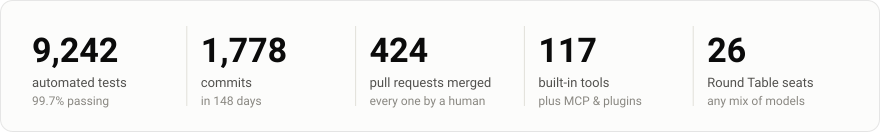
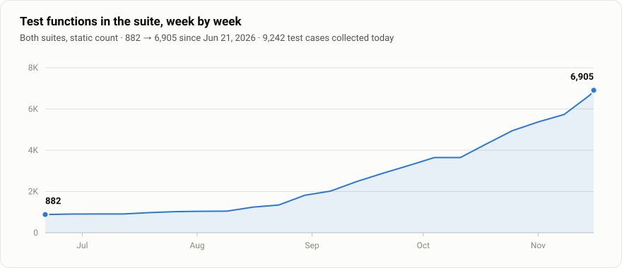
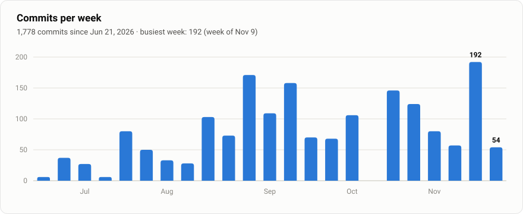
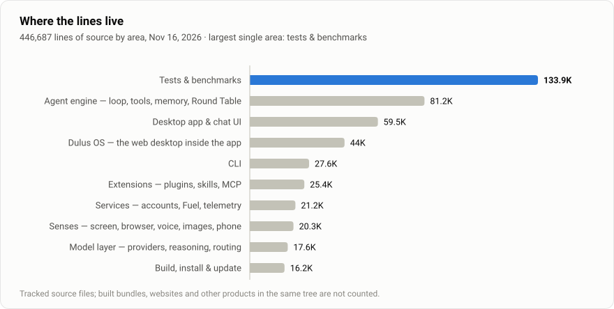

# How the Dulus desktop app is built

**Measured. Not claimed.** Every number on this page was taken from the repository on November 16, 2026 — git history, line counts and a full test run — and rechecked by [an audit](AUDIT.md). The raw data is in [`assets/stats.json`](assets/stats.json).

The Dulus desktop app is written by one person, [Kevin Rojo](https://x.com/KevRojo), using AI coding tools. Every change lands as a pull request that Kevin reviews and merges. Every working session ends with a signed entry in a shared log: what was done, what's still missing, what broke, what was learned — and what was **not** verified.

The source is private. This page is the part we can share: the process, the numbers, and the rules that keep both honest.

  <picture>
    <source media="(prefers-color-scheme: dark)" srcset="assets/at-a-glance-dark.svg">
    
  </picture>

## At a glance

| Metric | Value |
|---|---|
| **Automated tests** | **9,242** collected: 8,319 in the app suite and 923 in the accounts & Fuel service suite |
| **Latest full run** | **9,178 passed**, 26 failed, 38 skipped — 99.7% of the tests that ran ([details](#latest-full-run)) |
| **Test functions written** | **6,905**, up from 882 on the first day of the private tree — 7.8× |
| **Test code** | 395 test files, about 124,000 lines |
| **Commits** | **1,778** in 148 days (June 21 → November 16, 2026) |
| **Pull requests** | **424** merged since August 26 — every one by a human |
| **Shared log** | 219 session entries since August 15 |
| **Code that ships** | about 275,000 lines in the app, plus 134,000 lines of tests and benchmarks |

## The suite keeps growing

  <picture>
    <source media="(prefers-color-scheme: dark)" srcset="assets/tests-growth-dark.svg">
    
  </picture>

A test function can expand into several test cases, which is why 6,905 functions collect as 9,242 tests.

Data: test functions per week

| Week ending | Test functions |
|---|---:|
| Jun 21 | 882 |
| Jun 28 | 907 |
| Jul 5 | 909 |
| Jul 12 | 909 |
| Jul 19 | 975 |
| Jul 26 | 1,021 |
| Aug 2 | 1,041 |
| Aug 9 | 1,047 |
| Aug 16 | 1,242 |
| Aug 23 | 1,343 |
| Aug 30 | 1,817 |
| Sep 6 | 2,022 |
| Sep 13 | 2,477 |
| Sep 20 | 2,879 |
| Sep 27 | 3,256 |
| Oct 4 | 3,645 |
| Oct 11 | 3,645 |
| Oct 18 | 4,301 |
| Oct 25 | 4,942 |
| Nov 1 | 5,372 |
| Nov 8 | 5,734 |
| Nov 15 | 6,678 |
| Nov 16 | 6,905 |

## The pace

  <picture>
    <source media="(prefers-color-scheme: dark)" srcset="assets/commits-weekly-dark.svg">
    
  </picture>

Data: commits per week

| Week of | Commits |
|---|---:|
| Jun 15 | 6 |
| Jun 22 | 37 |
| Jun 29 | 27 |
| Jul 6 | 6 |
| Jul 13 | 80 |
| Jul 20 | 50 |
| Jul 27 | 33 |
| Aug 3 | 28 |
| Aug 10 | 103 |
| Aug 17 | 73 |
| Aug 24 | 171 |
| Aug 31 | 109 |
| Sep 7 | 158 |
| Sep 14 | 70 |
| Sep 21 | 68 |
| Sep 28 | 106 |
| Oct 5 | 0 |
| Oct 12 | 146 |
| Oct 19 | 124 |
| Oct 26 | 80 |
| Nov 2 | 57 |
| Nov 9 | 192 |
| Nov 16 | 54 |

## The rules every change follows

1. **Reproduce it first.** No fix starts from a guess. The failure is reproduced before anything changes — against real local servers, real browsers, real child processes, and a real compiler when that's where the bug lives.
2. **A test that fails without the fix.** Every fix lands with regression tests that were run against the old code and failed there. "Fails against the old code" shows up in almost every entry of the log.
3. **Break the fix on purpose.** Each piece of a fix is reverted, one at a time, and a test has to go red every time. Recent entries: 13 of 13 mutations caught (Round Table wake-ups), 17 of 17 (the live view), 29 caught in one merge of pricing code.
4. **Compare against a clean baseline.** The whole suite runs on the change *and* on an untouched copy of the base. Only new failures count — and anything that looks flaky is re-run on its own before anyone is allowed to call it flaky.
5. **Test the UI that ships.** Interface changes are verified in Chromium against the exact bundle that ships in the app, over HTTP and from a local file, with keyboard and mouse.
6. **Say what you didn't verify.** Every entry ends with its limits — no real provider call, no Windows run, no compiled binary. Said plainly, never implied.
7. **Root cause, not symptoms.** "It stopped erroring" is not "it's fixed."
8. **Security findings get the same treatment.** High-severity findings from automated static analysis are reproduced, fixed at the root and pinned with a regression test that fails on the old code.
9. **Kevin merges.** Every change goes through a pull request he reviews. 424 of 424.

### What an entry looks like

Trimmed from a real entry, translated from Spanish:

> **2026-11-07 — Round Table: whoever gets named in the chat wakes up**
>
> Kevin saw two things at the table: some agents' turns "got cut off", and out of 20 seats only 3 or 4 kept working while the rest said they were "on hold" — but didn't come back until the next round. […]
>
> **Validation:** 54 tests; 15 runs in a row and 18 in parallel, all green. 13 of 13 mutations caught (two of them forced us to strengthen the tests). End to end in Chromium against the real server. Full suite: 6,758 pass; every failure also fails on the base commit, except one that passes 5 of 5 on its own.
>
> **Watch out:** naming someone in passing wakes them up too. It costs them a short turn, which they're told to close in one line. […]

## Latest full run

November 16, 2026 · Linux · Python 3.12 · three parallel workers · an empty home directory · no provider keys.

| Suite | Passed | Failed | Skipped | Time |
|---|---:|---:|---:|---:|
| App | 8,262 | 26 | 31 | 16 min 35 s |
| Accounts & Fuel service | 916 | 0 | 7 ¹ | 21 s |
| Round Table scale and coordination checks | both green | — | — | — |

¹ Four integration modules need a local Postgres and three tests need a Redis stand-in, which this run didn't have.

The same suite was run on an untouched copy of the main branch, in the same environment. All 26 failures were there before this run, and we'd rather show them than hide them:

| What they are | Count |
|---|---:|
| Fail on their own, and on the untouched main branch too: expectations that drifted after deliberate changes (model catalogs, SDK headers, prompt wording), test fakes of desktop and window behavior that newer code outgrew, and three macOS packaging checks | 19 |
| Real failures still being investigated, both flagged on November 8 | 2 |
| Pass on their own, five runs out of five; they fail only under the parallel full run | 5 |

## What CI runs

On every push and every pull request:

- the app suite, offline, with no provider keys;
- the accounts & Fuel service suite;
- the Round Table scale and coordination checks;
- checks for the three websites — translations, links, asset stamps;
- the web front-end builds.

Desktop builds for Windows, macOS and Linux come from dedicated build scripts, which have their own regression tests: signing, the bundled browser, installers and what may or may not go into the app.

## Stories from the log

### The voice that only crashed when compiled
Astral Voice closed the whole app — but only in the shipped binary, and every test was green. We compiled the real voice module inside a harness, caught the crash in a debugger and found it: the release of the Python-to-native compiler we had upgraded to silently dropped a pending `return` whenever a loop inside a `finally:` block finished. We bisected the compiler's releases, pinned the last good one, moved those loops out of `finally:`, and added a test that compiles a probe and refuses to build if the compiler regresses. Then 300 iterations and more than 400 voice calls, with dropped connections and barge-ins thrown in: no crash.

### «¿Qué tal? Él dijo: «Ñandú, Árbol, ÜBER» — mañana 😀»
When Dulus first got hands on the desktop, "mañana" came out as "maana": the input layer underneath dropped anything that wasn't ASCII. Computer use now types native Unicode on Windows, macOS and Linux. The acceptance test types the line above into a real app on a real display server and checks that every character arrived. The stop button on the live overlay cut a running turn in 0.14 seconds.

### The feature a merge deleted
A merge conflict was resolved by keeping one side, and the hook that opened the live overlay quietly disappeared — only its docstring survived. The tests didn't notice, because they patched an internal function by name. Five of them had been failing on the main branch all along: *"that was the signal nobody saw."* Those tests now drive the real agent loop end to end, and they fail if the hook is removed.

### Eight thousand zeros
A crash in the middle of a write can leave a file at its new size with every byte set to zero. It happened to the agent's short-term memory — and on the next boot, the zeros were sealed as a valid memory and sent with every prompt. Every memory write is now atomic, reads strip and report damage, and a damaged file is set aside and rebuilt on boot.

### Twenty-five agents at one table
The Round Table used to keep every message of every seat on the page, and at 25 agents the app crawled. Now each seat draws only what you can see. Under a synthetic load of 25 agents and 40 rounds, the page went from 6,000 history elements and 5,001 layouts to 411 elements and 32 layouts.

### The benchmark that flattered us
Our own benchmark said Dulus ran six coding sessions for $25.63 against $48.00 for Claude Code, cheaper in all 42 matchups and first under every weighting. It was on the website. In November an audit ran it again and then read how it priced things, and found five errors, every one in Dulus's favour. Cache writes were free. Dulus was billed at a five-minute cache while it ships an hour-long one. The simulator trimmed old tool results on every turn, which the app never does, and those trims rewrote messages already sent without the simulator noticing. And one extreme row flattened every real cost difference. Each fix landed with a test that fails without it. The corrected run says Dulus is the only harness that never runs out of context, first under four of five weightings, and the cheapest once sessions pause, about one turn in eleven. On sessions that never pause, four harnesses cost less. That is what the website says now, under a dated correction. *[The benchmark](BENCHMARKS.md).*

## Lessons we wrote down

From the log, in the original Dominican Spanish:

- **«Compila ≠ funciona.»** — Compiles ≠ works. Open the installed app and click before you ship.
- **«Un número equivocado confirmándose a sí mismo. Peor que no tener tests.»** — A wrong number confirming itself is worse than having no tests. Seventeen green tests once agreed on the same mistake; tests now check the unit where a mistake is obvious.
- **«Con dinero real, evidencia circunstancial no basta.»** — With real money, circumstantial evidence isn't enough. Asking costs one turn; guessing wrong costs a lot more.
- **«Sin datos de mentira: una mesa quieta se ve quieta y una vacía lo dice.»** — No fake data: a quiet table looks quiet, and an empty one says so. A panel with no data says so instead of showing a placeholder number.
- **«Esa era la señal que nadie vio.»** — That was the signal nobody saw. A test that fails "as usual" is still telling you something.
- **«Un benchmark que siempre gana no está midiendo.»** — A benchmark that always wins isn't measuring. Ours won everything until someone checked how it priced a cache write.

## The codebase, without the code

No file names, no code — just where the weight is.

  <picture>
    <source media="(prefers-color-scheme: dark)" srcset="assets/codebase-dark.svg">
    
  </picture>

| Area | Lines | Ships in the app |
|---|---:|:---:|
| Tests & benchmarks | 133,858 | — |
| Agent engine — loop, tools, memory, Round Table | 81,160 | ✓ |
| Desktop app & chat UI | 59,484 | ✓ |
| Dulus OS — the web desktop inside the app | 44,024 | ✓ |
| CLI | 27,561 | ✓ |
| Extensions — plugins, skills, MCP | 25,355 | ✓ |
| Services — accounts, Fuel, telemetry | 21,186 | — |
| Senses — screen, browser, voice, images, phone | 20,277 | ✓ |
| Model layer — providers, reasoning, routing | 17,627 | ✓ |
| Build, install & update | 16,155 | — |

About 275,000 lines ship in the app. For every ten of them, there are about five lines of tests.

## What we don't publish

The source code, our infrastructure, and how the features work inside. If you want to read code, the open-source core is on GitHub at [KevRojo/Dulus](https://github.com/KevRojo/Dulus).

## How each number was measured

- **Commits and pull requests:** git history of the main branch at the commit measured on November 16, 2026; merges are counted separately.
- **Test functions:** a static count of test functions in both suites, on the last commit of each week.
- **Collected tests and the full run:** pytest with the full set of requirements installed, as described [above](#latest-full-run).
- **Lines:** tracked source files (Python, TypeScript, JavaScript, CSS, HTML and shell scripts). Built bundles, vendored code, the websites and other products that share the repository are not counted.
- **Raw data:** [`assets/stats.json`](assets/stats.json).
