

  

<h1 align="center">Dulus</h1>

  <b>El motor privado detrás de la app de escritorio de Dulus.</b> 
  La parte de Dulus que no se instala con <code>pip install</code>.

  <a href="https://dulus.ai/es/download/"><b>Descarga la app</b></a> ·
  <a href="https://dulus.ai/es/pricing/"><b>Planes</b></a> ·
  <a href="FEATURES.md">Funciones</a> ·
  <a href="ENGINEERING.md">Cómo se construye</a> ·
  <a href="BENCHMARKS.md">Benchmark</a> ·
  <a href="AUDIT.md">Auditoría</a> ·
  <a href="DEVLOG.md">Bitácora</a> ·
  <a href="README.md">English</a>

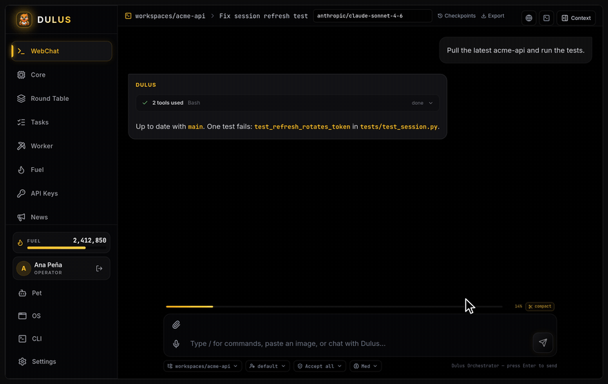

<a href="https://dulus.ai/es/download/"><b>Descárgala gratis</b></a> · <a href="https://dulus.online/es/account/?plan=operator#plans"><b>Obtener Operator: $147 de Fuel por $49 al mes</b></a> · <a href="https://dulus.ai/es/pricing/">Planes</a>

  <picture>
    <source media="(prefers-color-scheme: dark)" srcset="assets/at-a-glance-dark.svg">
    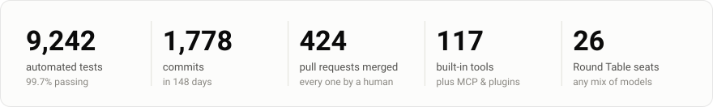
  </picture>

---

## "¿Eso es todo?"

Si instalaste Dulus desde GitHub y pensaste *¿eso es todo?*, conociste el núcleo, no la app.

Dulus empezó como un agente de terminal de código abierto. Sigue en GitHub, sigue gratis y sigue siendo un buen lugar para trastear. La **app de escritorio de Dulus** es todo lo que creció encima: la experiencia completa que descargas en [dulus.ai](https://dulus.ai/es/download/). Esta página reúne qué hace, el trabajo detrás y las mediciones que lo respaldan.

> Dulus es un agente de IA para tu escritorio y tu terminal. Trabaja en tus archivos, tu shell, tu navegador y tu pantalla — con el modelo que elijas. Y cuando una sola mente no basta, llama a la bandada.

## Míralo trabajar

Cada clip es la interfaz misma de la app de escritorio corriendo una demo: datos de demo, la interfaz real. Lo que ves es lo que la app dibuja.

### Mesa Redonda
Sienta modelos distintos en una mesa. Lo discuten, se llaman por su nombre, y Dulus te trae una sola respuesta.

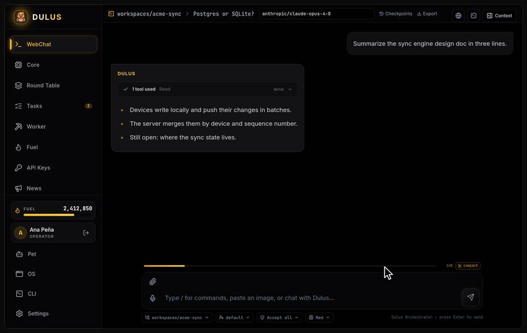

### Cualquier modelo, a mitad de la conversación
Cámbialo con <code>/model</code> y la próxima respuesta ya es del nuevo: tus propias claves, un modelo en tu máquina o los modelos alojados por Dulus.

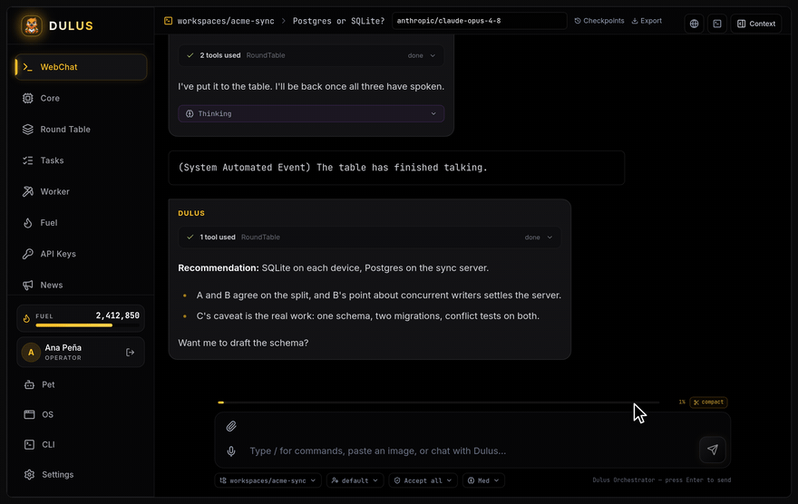

### Nada riesgoso sin tu permiso
Un comando que no se puede deshacer pregunta primero, en el mismo chat: lo apruebas una vez, o siempre.

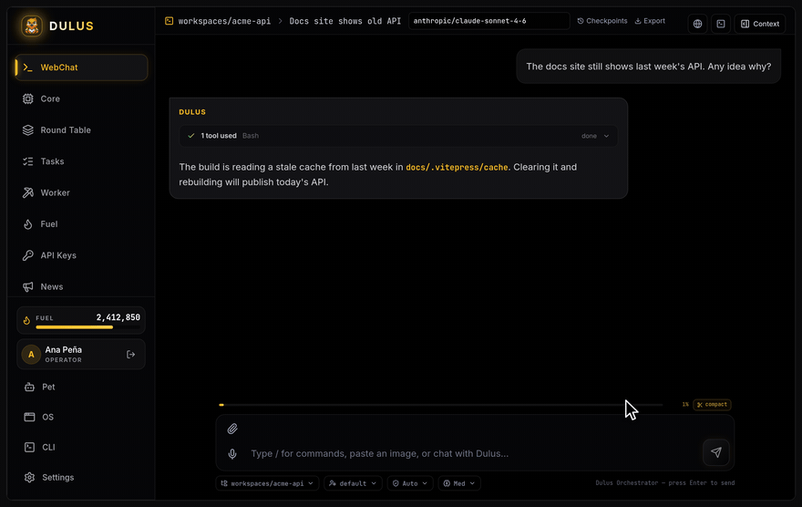

### Un navegador de verdad que maneja
Navega por ti en WebDrive, un navegador de verdad dentro de la app, y te dice qué leyó.

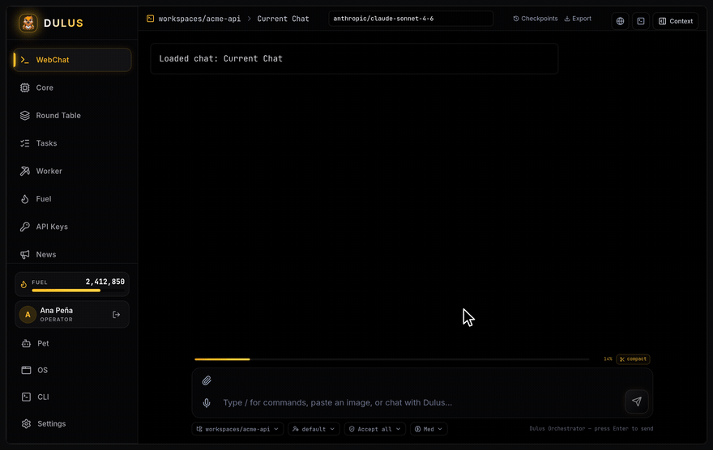

### Las decisiones son tuyas
Lo que solo tú puedes decidir te espera aquí. Contéstalo, y el trabajo que esperaba puede arrancar.

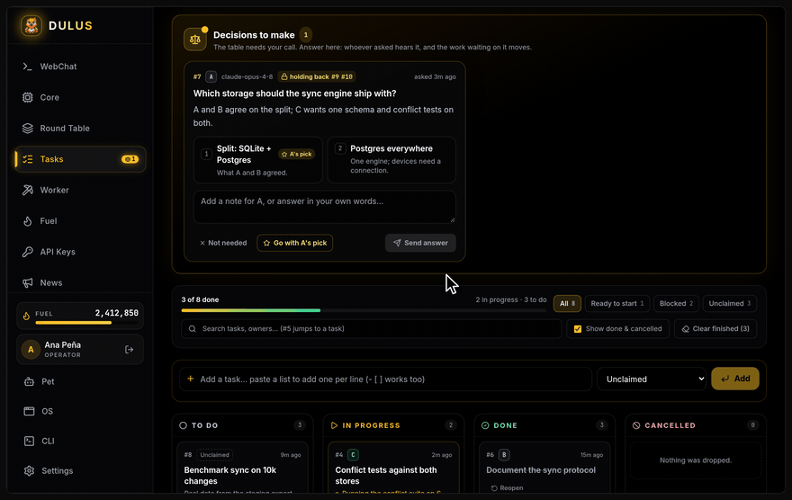

### ~1,800 servidores MCP, instalados como conexiones
Escoges uno del market, lo instalas, inicias sesión y sus herramientas quedan listas.

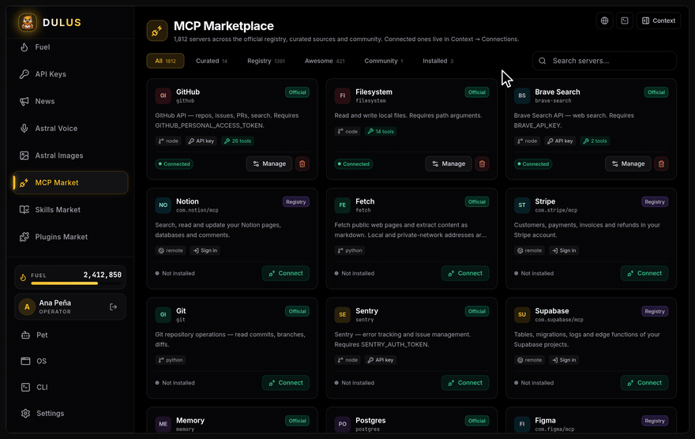

### Un catálogo abierto de plugins
1,508 plugins abiertos, de la A a la Z: busca, filtra, lee uno y Auto-adapt lo convierte en herramientas nativas.

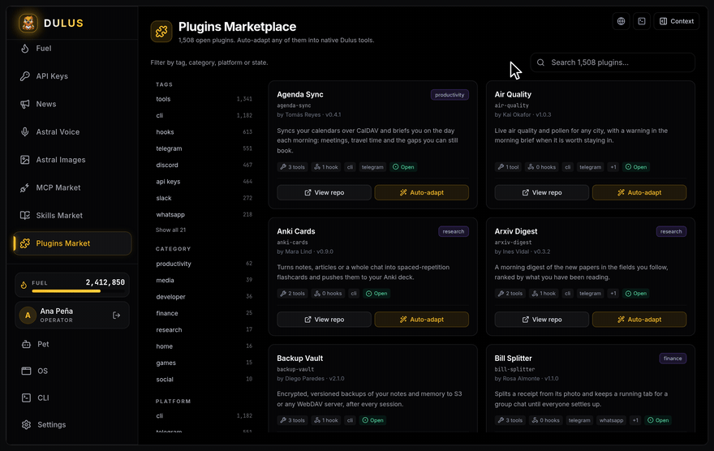

### Packs de skills
Skills curados para un tipo de trabajo, instalados en su propio workspace y perfil.

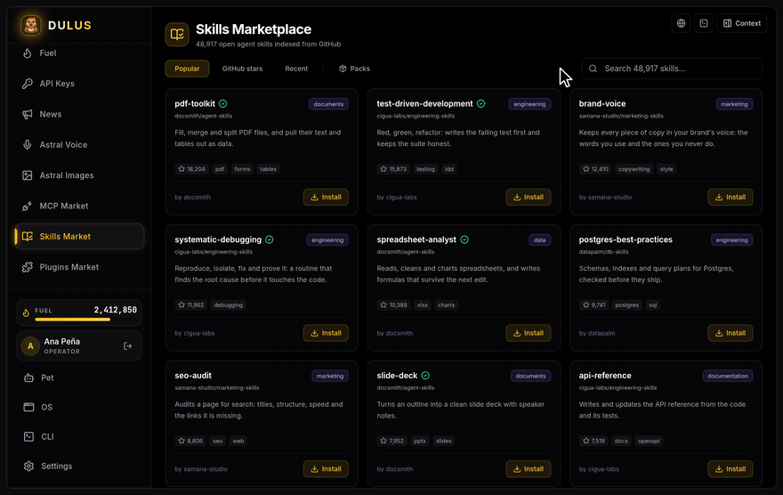

### Astral Images
Con tus propias claves: un prompt hace una imagen, y la imagen es la referencia de la siguiente.

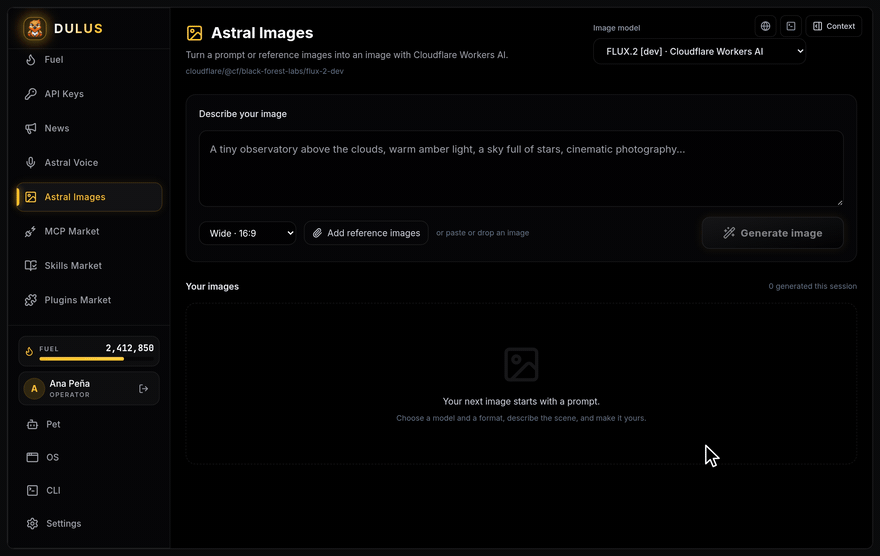

### Astral Video
Kling, Veo o Sora con tus propias claves. Describe la toma, y se renderiza mientras sigues trabajando.

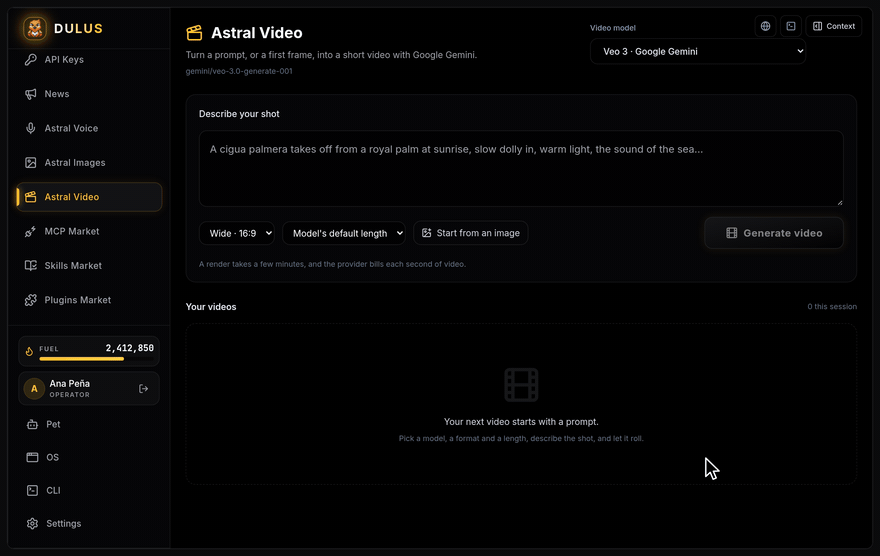

### 17 temas
Y un acento tuyo. Cada uno repinta toda la app con solo apuntarlo.

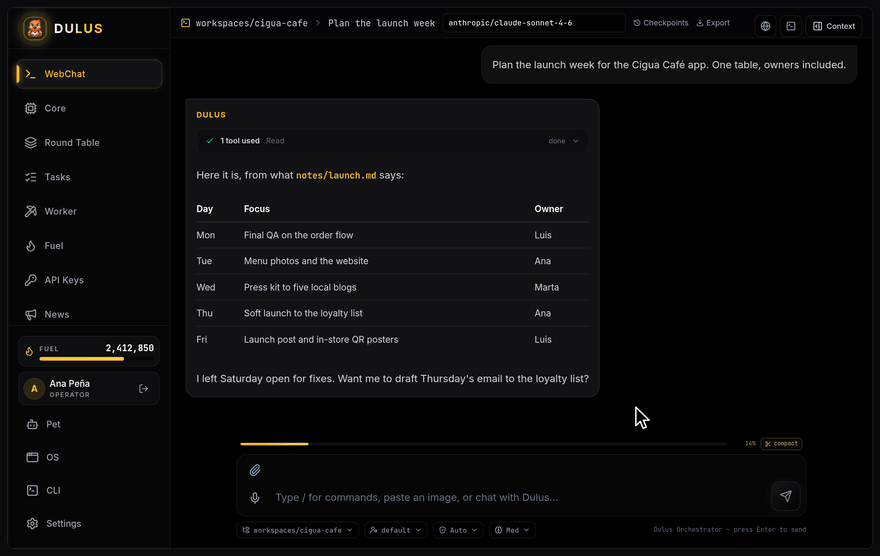

### Una terminal en vivo
Abre la terminal y mira a Dulus correr sus comandos en un shell de verdad, línea a línea.

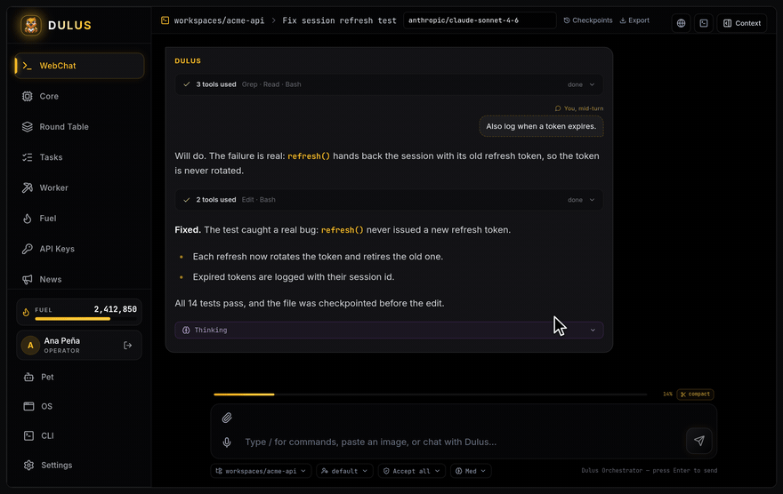

### Todos los comandos, a una tecla
Escribe / y salen todos los comandos: unas letras encuentran uno, Tab elige y Enter lo corre.

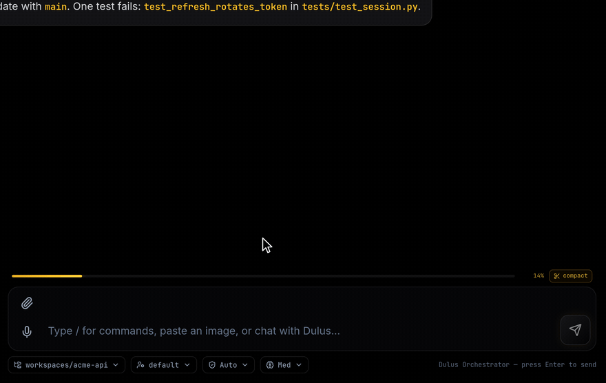

### La API, a un clic
Las claves de API llevan los modelos de Dulus a tu código: un endpoint compatible con OpenAI, pagado con tu Fuel.

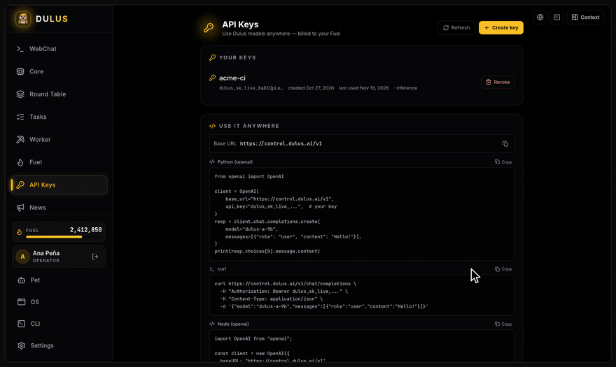

### Fuel, primero con tarjeta
Fuel paga los modelos alojados por Dulus, y tu plan lo llena cada mes. Cada movimiento queda en el historial.

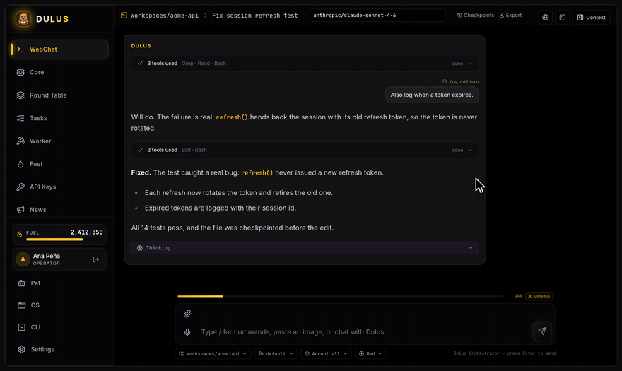

## Free corre con tus claves. Operator, con las nuestras.

La app es gratis con tus propias claves de API o un modelo local. **Operator** pone la IA: $147 de Fuel cada mes por $49, todos los modelos alojados por Dulus sin claves que administrar, una cloud PC tuya, Dulus OS y la API.

| | **Free** | **Operator** · $49 al mes | **Company** · $99 al mes |
|---|:---:|:---:|:---:|
| La app de escritorio, cada herramienta, la Mesa Redonda y la memoria | ✓ | ✓ | ✓ |
| Tus propias claves y modelos locales, $0 de Dulus | ✓ | ✓ | ✓ |
| **Fuel cada mes**, el triple de lo que pagas | — | **$147** | **$297** |
| Todos los modelos alojados por Dulus, sin claves que administrar | con Fuel | ✓ | ✓ |
| Una cloud PC tuya, sincronizada por la app de escritorio | — | ✓ | ✓ |
| Dulus OS, el escritorio en tu navegador | — | ✓ | ✓ |
| La API compatible con OpenAI, con el mismo Fuel | con Fuel | ✓ | ✓ |
| | **[Descargar](https://dulus.ai/es/download/)** | **[Obtener Operator →](https://dulus.online/es/account/?plan=operator#plans)** | **[Obtener Company →](https://dulus.online/es/account/?plan=company#plans)** |

Se paga con tarjeta en Dodo Payments: el pago se abre justo después de iniciar sesión, con el correo con el que entras. Los tokens que ya están en caché no cuestan nada, y una llamada que el modelo nunca corrió se reembolsa. También puedes recargar Fuel con SOL o $DULUS en Solana. $DULUS es un token de utilidad y comunidad que se usa para pagar Fuel en Dulus. Nada aquí es asesoría financiera.

## Un agente. Hecho de muchos.

### La Mesa Redonda
Sienta hasta **26 agentes de IA** — con cualquier mezcla de modelos — en una misma mesa con un tablero de tareas compartido. Se reparten el trabajo, se llaman por su nombre y te traen las decisiones que solo tú puedes tomar, en tarjetas con opciones y una recomendación. Abre la vista en vivo para ver la mesa trabajando, dibujada con eventos reales, nada inventado, y tómale una foto o grábala.

### Manos en tu computadora
Dulus ve la pantalla, hace clic y escribe en cualquier app, en cualquier idioma — con tildes, ñ y emoji. Un pequeño panel en vivo lo acompaña encima de las apps en pantalla completa, para que lo veas, le apruebes cosas o lo pares con un clic.

### Astral Voice
Háblale. Empieza a contestarte en voz alta mientras todavía escribe, te deja interrumpirlo y guarda toda la conversación en una transcripción al lado del orbe.

### Tu teléfono, la misma conversación
Vincula Telegram con un código QR y sigue desde donde estés: texto, notas de voz, fotos y archivos, el progreso en vivo con un botón para parar y aprobaciones con botones.

### Una memoria que no te miente
Los recuerdos se quedan con el perfil de donde salieron. Los datos viejos se marcan en vez de darse por ciertos, los nuevos reemplazan a los anteriores y los viejos se archivan, nunca se borran a escondidas. Las conversaciones largas se pueden buscar aunque ya se hayan compactado.

### Cualquier modelo
**26 integraciones de proveedores** — las APIs grandes, modelos locales y los modelos alojados por Dulus — con un solo control de razonamiento para todos, ventanas de contexto de hasta un millón de tokens donde el proveedor las ofrece y peticiones pensadas para quedarse en caché, así las sesiones largas cuestan menos.

### Crea cosas
Imágenes y video con tus propias claves: FLUX.2, GPT Image, Gemini e Imagen, Meta Muse, Veo, Sora 2 y más. Arrastra un resultado de vuelta como referencia y sigue. Los documentos y mini apps que construye el agente quedan en una biblioteca de **Artifacts** con versiones.

### Crece contigo
Un mercado de **~1,800 servidores MCP** que se instalan desde la misma app, con sus runtimes incluidos. Skills. Plugins que se recargan en vivo. Y **AutoAdapter**: dale un repo de GitHub y te devuelve herramientas que se verifican antes de encenderse.

### Y todo lo de alrededor
Un navegador de verdad dentro de la app, un panel de terminal en vivo, un globito para hablarle a Dulus a mitad de tarea sin pararlo, un Stop que de verdad para, checkpoints con deshacer y bifurcar, reportes en HTML, un tablero de tareas, Dulus OS, una mascota de escritorio, 17 temas y respuestas en 22 idiomas.

**→ [La lista completa de funciones](FEATURES.md)** (en inglés)

## Medido, no prometido.

La app de escritorio la construye un solo desarrollador, [Kevin Rojo](https://x.com/KevRojo), con herramientas de IA para programar. Cada cambio entra como un pull request que Kevin revisa y mergea: los 424. Cada sesión de trabajo termina con una entrada firmada en una bitácora compartida: qué se hizo, qué falta, qué se rompió y qué **no** se verificó.

  <picture>
    <source media="(prefers-color-scheme: dark)" srcset="assets/tests-growth-dark.svg">
    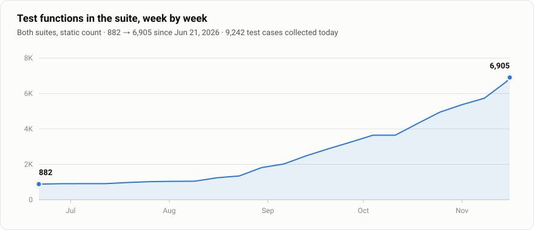
  </picture>

- **9,242 pruebas automatizadas.** La última corrida completa (16 de noviembre de 2026) pasó 9,178; los 26 fallos ya estaban antes y están desglosados en [ENGINEERING.md](ENGINEERING.md#latest-full-run).
- **Cada arreglo llega con una prueba que falla sin él**, y rompemos cada arreglo a propósito para comprobar que una prueba lo atrapa.
- **1,778 commits en 148 días.**
- **La parte más grande del código es la suite de pruebas**: unas 134,000 líneas, frente a unas 275,000 que van dentro de la app.
- **219 entradas** en la bitácora compartida desde el 15 de agosto. La versión pública es la [bitácora](DEVLOG.md).
- **Un benchmark que reporta sus propias derrotas.** Se corrió de nuevo el 16 de noviembre, se corrigió donde nos favorecía y se publicó con lo que tenía mal: **[el benchmark](BENCHMARKS.md)** (en inglés).
- **Una auditoría.** Claude Opus 5.5 volvió a correr la suite y el benchmark y recontó cada número de estas páginas: **[la auditoría](AUDIT.md)** (en inglés).

**→ [Cómo se construye la app de escritorio](ENGINEERING.md)** (en inglés)

## Dos ediciones, una sola ave

| | **Dulus** — código abierto | **App de escritorio de Dulus** |
|---|---|---|
| **Qué es** | El agente de terminal donde empezó todo | El producto completo: app de escritorio, terminal y teléfono |
| **Dónde** | [github.com/KevRojo/Dulus](https://github.com/KevRojo/Dulus) · `pip install dulus` | [dulus.ai/download](https://dulus.ai/es/download/) |
| **Código** | Abierto — este repo | Privado |
| **Precio** | Gratis | Gratis con tus claves. Operator: $147 de Fuel por $49 al mes, con los modelos alojados, una cloud PC y Dulus OS |

Todo lo que ves en esta página vive en la app de escritorio.

## Descárgala

**[Descarga Dulus](https://dulus.ai/es/download/)** para Windows 10/11 (x64). Las versiones para macOS (Apple Silicon) y Linux aparecen en esa misma página a medida que se publican.

**¿Ya usas Dulus instalado con `pip`?** Escribe `/app`. Instala la última versión para tu sistema desde [dulus-updates](https://github.com/Dulus-Ai/dulus-updates/releases/latest), donde llegan las actualizaciones.

**Gratis con tus claves, o con la IA incluida.** Inicias sesión con una cuenta gratis de Dulus, y tus propias claves y modelos locales no te cuestan nada con Dulus. **[Operator](https://dulus.online/es/account/?plan=operator#plans)** pone $147 de [Fuel](https://dulus.ai/es/fuel/) en tu cuenta cada mes por $49, con tarjeta: todos los modelos alojados por Dulus sin claves que administrar, una cloud PC tuya y Dulus OS. [Compara los planes](https://dulus.ai/es/pricing/).

## Preguntas frecuentes

### La app es gratis. ¿Por qué pagar?
Porque Free corre con tus claves y un plan corre con las nuestras. En Free la IA la pones tú: tus propias claves de API o un modelo en tu máquina. **Operator** pone $147 de Fuel en tu saldo cada mes por $49, para todos los modelos alojados por Dulus sin configurar nada, y abre lo que solo un plan tiene: una cloud PC tuya y Dulus OS. [Obtener Operator](https://dulus.online/es/account/?plan=operator#plans).

### ¿La app de escritorio es de código abierto?
No. Dulus, el núcleo de código abierto, sí lo es, y lo seguirá siendo. El código de la app de escritorio no se publica; esta página enseña qué hace, cómo se construye y cómo se prueba.

### ¿Por qué mantenerlo privado?
Porque mucho de lo que ves aquí no existe en ningún otro lado, y preferimos enseñar el trabajo antes que regalar los planos.

### ¿De dónde salen los números?
Del propio repositorio, medidos el 16 de noviembre de 2026: el historial de git, el conteo de líneas y una corrida completa de las pruebas, revisados por [una auditoría](AUDIT.md). Los datos crudos están en [`assets/stats.json`](assets/stats.json) y el método, en [ENGINEERING.md](ENGINEERING.md).

### ¿Dulus es el agente más barato de correr?
Depende de si haces pausas. En nuestro benchmark Dulus es el único agente que nunca se quedó sin contexto, y el más barato en cuanto uno de cada once turnos vuelve después de una pausa de más de cinco minutos, porque guarda la caché de su prompt durante una hora. En sesiones sin ninguna pausa, cuatro de los seis agentes que modelamos cuestan menos. Los números, y lo que tuvimos mal la primera vez, están en [BENCHMARKS.md](BENCHMARKS.md).

### ¿$DULUS es una inversión?
No. $DULUS es un token de utilidad y comunidad que se usa para pagar Fuel en Dulus. Nada aquí es asesoría financiera.

### ¿Dónde reporto un bug?
[Abre un issue](../../issues/new/choose) aquí o escríbenos a hello@dulus.ai. Los reportes de seguridad van en privado a security@dulus.ai; mira [SECURITY.md](SECURITY.md).

## Hecho por uno. Respaldado por muchos.

Lo hace Kevin Rojo, un desarrollador independiente de Santo Domingo. Con el apoyo de **Datadog**, **Cloudflare**, **Sentry**, **Mixpanel**, **Amplitude**, **AWS Activate**, **Claude for Startups**, **DigitalOcean Hatch**, **Notion** y **Zendesk**.

## ¿Por qué un ave?

Dulus lleva el nombre de la cigua palmera, ave nacional de la República Dominicana. Vive en La Española y en ningún otro lugar del planeta, y es la única especie de su familia.

Las ciguas palmeras viven en bandadas. Juntas levantan un gran nido de ramitas, uno solo, en lo alto de las palmas reales, y adentro cada pareja tiene su propia cámara, con su propia entrada. Un techo, muchos cuartos. Dulus funciona igual: un solo agente, hecho de muchos — cada modelo, cada herramienta y cada asiento de la Mesa Redonda en su propio cuarto, bajo un mismo techo.

Lleva el nombre del ave, no del cohete. Hecho en Santo Domingo 🇩🇴 · Seguimos volando.

