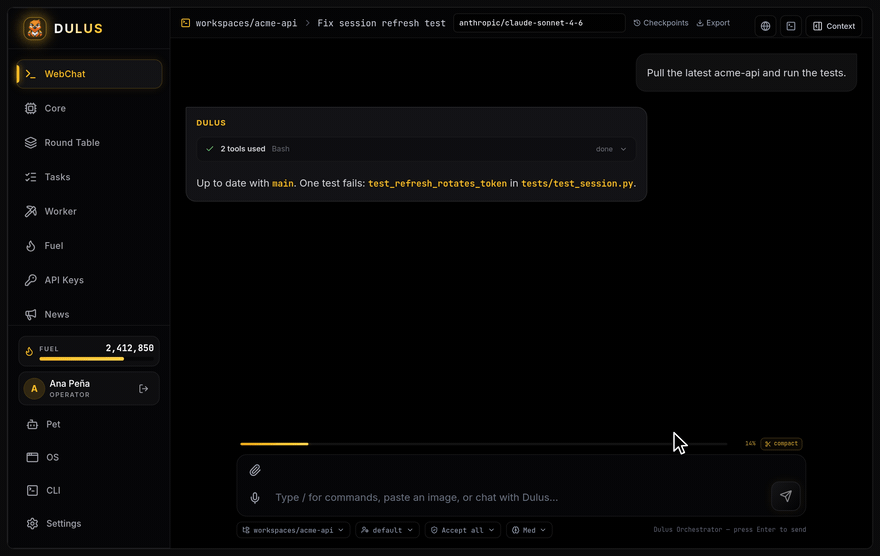
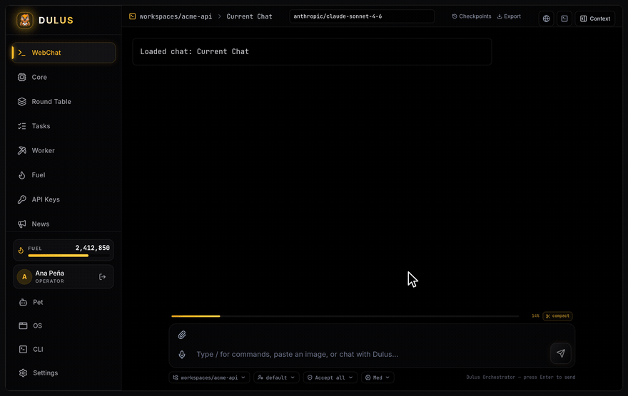
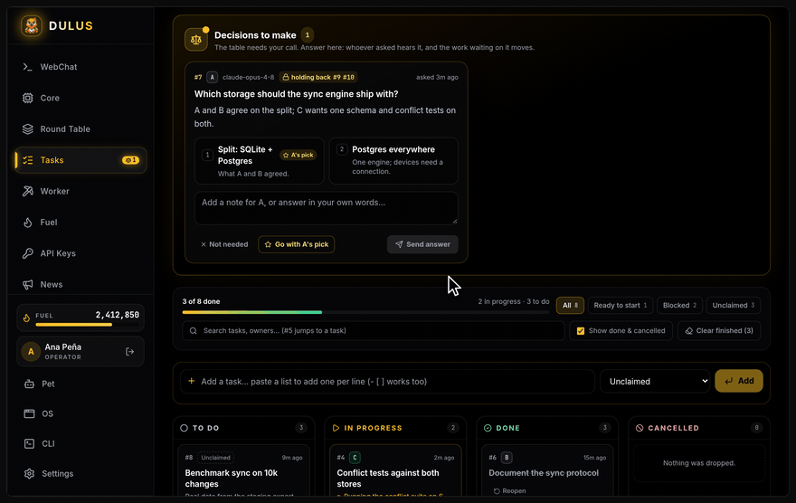
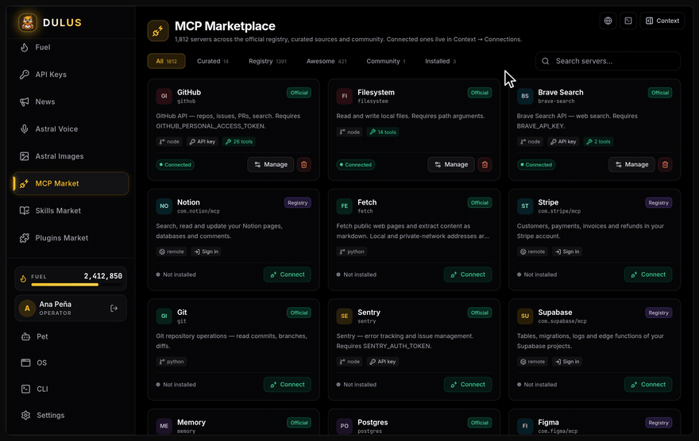
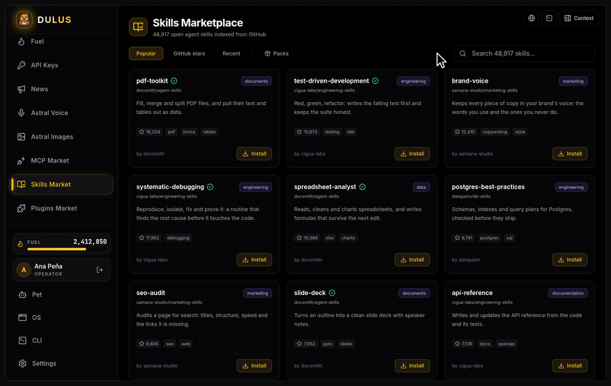
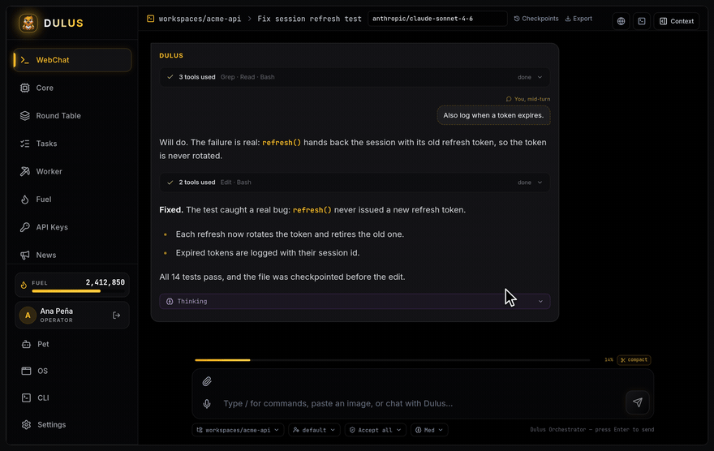
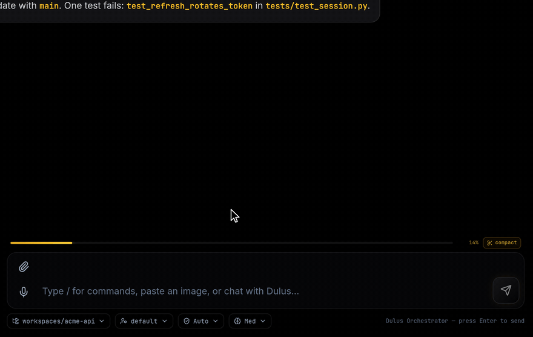
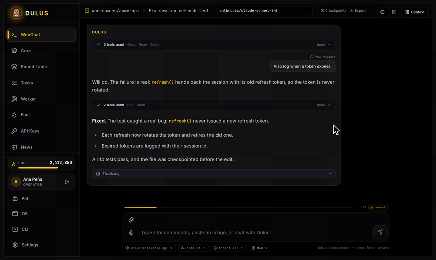

  

<h1 align="center">Dulus</h1>

  <b>Your AI teammate for the desktop and terminal.</b> 
  The part of Dulus you can't <code>pip install</code>.

  <a href="https://dulus.ai/download/"><b>Download the app</b></a> ·
  <a href="https://dulus.ai/pricing/"><b>Plans</b></a> ·
  <a href="FEATURES.md">Features</a> ·
  <a href="ENGINEERING.md">How it's built</a> ·
  <a href="DEVLOG.md">Build log</a> ·
  <a href="README.es.md">Español</a>

  
  
  
  
  
  
  

<a href="https://dulus.ai/download/"><b>Download free</b></a> · <a href="https://dulus.online/account/?plan=operator#plans"><b>Get Operator: $147 of Fuel for $49 a month</b></a> · <a href="https://dulus.ai/pricing/">Plans</a>

  <picture>
    <source media="(prefers-color-scheme: dark)" srcset="assets/at-a-glance-dark.svg">
    
  </picture>

---

## "That's it?"

If you installed Dulus from GitHub and thought *that's it?* — you met the core, not the app.

Dulus started as an open-source terminal agent. It's still on GitHub, still free, and still a fine place to hack. The **Dulus desktop app** is everything that grew on top of it: the full desktop experience you download from [dulus.ai](https://dulus.ai/download/). This showcase brings together what it does, the work behind it and the measurements that back it up.

> Dulus is an AI agent for your desktop and terminal. It works in your files, your shell, your browser and your screen — on any model you choose. And when one mind isn't enough, it calls the flock.

## See it work

Every clip is the desktop app's own interface playing a demo run: demo data, the real interface. What you see is what the app draws.

### Mesa Redonda
Seat different models at one table. They argue it out, call on each other by name, and Dulus brings back one answer.

### Any model, mid-conversation
Switch with <code>/model</code> and the next answer comes from the new one: your own keys, a model on your machine or the Dulus-hosted lineup.

### Nothing risky without your OK
A command that can't be undone asks first, right in the chat: approve it once, or always.

### A real browser it drives
It browses for you in WebDrive, a real browser inside the app, and reads the page back.

### Decisions stay yours
What only you can decide waits for you here. Answer it, and the work waiting on it can start.

### ~1,800 MCP servers, installed as connections
Pick one from the market, install it, sign in, and its tools are ready.

### An open catalog of plugins
1,508 open plugins, A to Z: search, filter, read one, and Auto-adapt turns it into native tools.

### Skill packs
Curated skills for one kind of work, installed in a workspace and profile of their own.

### Astral Images
On your own keys: a prompt makes a picture, and the picture becomes the reference for the next one.

### Astral Video
Kling, Veo or Sora on your own keys. Describe the shot, and it renders while you keep working.

### 17 themes
And an accent of your own. Each one repaints the whole app as you point at it.

### A live terminal
Open the terminal and watch Dulus run its commands in a real shell, line by line.

### Every command, one keystroke away
Type / for every command: a few letters find one, Tab picks its option, Enter runs it.

### The API, one click away
API keys take the Dulus models into your own code: an OpenAI-compatible endpoint, paid with your Fuel.

### Fuel, by card first
Fuel pays for the Dulus-hosted models, and your plan fills it every month. Every movement lands in the ledger.

## Free runs on your keys. Operator runs on ours.

The app is free on your own API keys or a local model. **Operator** brings the AI: $147 of Fuel every month for $49, every Dulus-hosted model with no keys to manage, a cloud PC of your own, Dulus OS and the API.

| | **Free** | **Operator** · $49 a month | **Company** · $99 a month |
|---|:---:|:---:|:---:|
| The desktop app, every tool, Mesa Redonda and memory | ✓ | ✓ | ✓ |
| Your own API keys and local models, $0 from Dulus | ✓ | ✓ | ✓ |
| **Fuel every month**, three times what you pay | — | **$147** | **$297** |
| Every Dulus-hosted model, no keys to manage | with Fuel | ✓ | ✓ |
| A cloud PC of your own, kept in sync by the desktop app | — | ✓ | ✓ |
| Dulus OS, the desktop in your browser | — | ✓ | ✓ |
| The OpenAI-compatible API, on the same Fuel | with Fuel | ✓ | ✓ |
| | **[Download](https://dulus.ai/download/)** | **[Get Operator →](https://dulus.online/account/?plan=operator#plans)** | **[Get Company →](https://dulus.online/account/?plan=company#plans)** |

Paid by card with Dodo Payments: checkout opens right after you sign in, with the email you sign in with. Tokens already in the cache cost nothing, and a call the model never ran is refunded. You can also top up Fuel with SOL or $DULUS on Solana. $DULUS is a utility and community token used to pay for Fuel on Dulus. Nothing here is financial advice.

## One agent. Made of many.

### The Round Table
Seat up to **26 AI agents** — any mix of models — at one table with a shared task board. They split the work, call on each other by name, and bring you the decisions only you can make as cards with options and a recommended pick. Open the live view to watch the table work, drawn from real events, never invented — then take a photo or record it.

### Hands on your computer
Dulus sees the screen, clicks and types in any app, in any language — accents, ñ and emoji included. A small live overlay follows along over full-screen apps, so you can watch, approve or stop it with one click.

### Astral Voice
Talk to it. It starts answering out loud while it's still writing, lets you cut in, and keeps the whole conversation in a transcript beside the orb.

### Your phone, same conversation
Pair Telegram with a QR code and keep going from anywhere: text, voice notes, photos and files, live progress with a stop button, approvals as buttons.

### Memory that doesn't lie to you
Memories stay with the profile and project they came from. Stale facts get flagged instead of trusted, newer facts replace older ones, and old ones are archived, never silently deleted. Long conversations stay searchable even after they're compacted.

### Any model
**40+ provider integrations** — the major APIs, local runtimes, and Dulus's own hosted models — with one reasoning dial for all of them, context windows up to a million tokens where the provider offers them, and requests shaped to stay cached so long sessions cost less.

### Make things
Images and video with your own keys: FLUX.2, GPT Image, Gemini and Imagen, Meta Muse, Veo, Sora 2 and more. Drag a result back in as a reference and keep going. Documents and mini apps the agent builds land in a versioned **Artifacts** library.

### Grows with you
A market of **~1,800 MCP servers** that install from inside the app, runtimes included. Skills. Plugins that reload live. And **AutoAdapter**: point it at a GitHub repo and get tools that are verified before they're switched on.

### And everything around it
A real browser pane, a live terminal panel, a steer bubble to talk to Dulus mid-task without stopping it, a Stop that really stops, checkpoints with undo and fork, HTML reports, a Tasks board, Dulus OS, a desktop pet, 14 themes and 34 languages.

**→ [The full feature list](FEATURES.md)**

## Measured. Not claimed.

Dulus is built by one developer, [Kevin Rojo](https://x.com/KevRojo), using AI coding tools. Every change lands as a pull request that Kevin reviews and merges — all 424 of them. Every working session ends with a signed entry in a shared log: what was done, what's missing, what broke, and what was **not** verified.

  <picture>
    <source media="(prefers-color-scheme: dark)" srcset="assets/tests-growth-dark.svg">
    
  </picture>

- **9,242 automated tests.** The latest full run (Nov 16, 2026) passed 9,178; the 26 failures were all there before it, and are broken down in [ENGINEERING.md](ENGINEERING.md#latest-full-run).
- **Every fix ships with a test that fails without it** — and we break each fix on purpose to prove a test catches it.
- **1,778 commits in 148 days.**
- **The biggest single area of the codebase is the test suite** — about 134,000 lines, next to roughly 275,000 that ship in the app.
- **219 signed entries** in the shared log since August 15. A cleaned-up version is the [build log](DEVLOG.md).

**→ [How Dulus is built](ENGINEERING.md)**

### Shipping, week by week

The commit history behind the product, shown week by week.

  <picture>
    <source media="(prefers-color-scheme: dark)" srcset="assets/commits-weekly-dark.svg">
    
  </picture>

### Where the work goes

The measured distribution of the project by area, including its test suite.

  <picture>
    <source media="(prefers-color-scheme: dark)" srcset="assets/codebase-dark.svg">
    
  </picture>

### Explore the work

| | Read more |
|---|---|
| **What the app does** | [Full feature catalog](FEATURES.md) |
| **How the work is checked** | [Engineering, measurement methods and known test failures](ENGINEERING.md) |
| **What has shipped** | [Dated product build log](DEVLOG.md) |
| **The figures behind the charts** | [Measurement snapshot: November 16, 2026](assets/stats.json) |
| **Security reports** | [Security policy](SECURITY.md) |
| **Showcase content** | [Content license](LICENSE) |

## Two editions, one bird

| | **Dulus** — open source | **Dulus desktop app** |
|---|---|---|
| **What it is** | The terminal agent where it all started | The full product: desktop app, terminal and phone |
| **Get it** | [github.com/KevRojo/Dulus](https://github.com/KevRojo/Dulus) · `pip install dulus` | [dulus.ai/download](https://dulus.ai/download/) |
| **Source** | Open — this repo | Private |
| **Price** | Free | Free on your own keys. Operator: $147 of Fuel for $49 a month, with the hosted models, a cloud PC and Dulus OS |

Everything on this page lives in the desktop app.

## Get it

**[Download Dulus](https://dulus.ai/download/)** for Windows (x64) and macOS (Apple Silicon). Check the download page for current builds, requirements and platform availability.

**Already running Dulus from `pip`?** Type `/app`. It installs the latest build for your OS from [dulus-updates](https://github.com/Dulus-Ai/dulus-updates/releases/latest), where the updates land.

**Free on your keys, or with the AI included.** You sign in with a free Dulus account, and your own keys and local models cost nothing from Dulus. **[Operator](https://dulus.online/account/?plan=operator#plans)** puts $147 of [Fuel](https://dulus.ai/fuel/) in your account every month for $49, by card: every Dulus-hosted model with no keys to manage, a cloud PC of your own and Dulus OS. [Compare the plans](https://dulus.ai/pricing/).

## FAQ

### The app is free. Why pay?
Because Free runs on your keys and a plan runs on ours. On Free you bring the AI: your own API keys, or a model on your own machine. **Operator** puts $147 of Fuel in your balance every month for $49, for every Dulus-hosted model with nothing to set up, and opens what only a plan has: a cloud PC of your own and Dulus OS. [Get Operator](https://dulus.online/account/?plan=operator#plans).

### Is the desktop app open source?
No. Dulus, the open-source core, is — and stays that way. The desktop app's source isn't published; this showcase shows what it does, how it's built and how it's tested.

### Why keep it private?
Because a lot of what's on this page exists nowhere else, and we'd rather show the work than hand over the blueprint.

### Where do the numbers come from?
From the repository itself, measured on November 16, 2026: git history, line counts and a full test run. The raw data is in [`assets/stats.json`](assets/stats.json) and the method is in [ENGINEERING.md](ENGINEERING.md).

### Is $DULUS an investment?
No. $DULUS is a utility and community token used to pay for Fuel on Dulus. Nothing here is financial advice.

### Where do I report a bug?
[Open an issue](mailto:hello@dulus.ai) here, or write to hello@dulus.ai. Security reports go privately to security@dulus.ai — see [SECURITY.md](SECURITY.md).

## Built by one. Backed by many.

Made by Kevin Rojo, a solo developer in Santo Domingo. Supported by **Datadog**, **Cloudflare**, the **OVHcloud Startup Program**, **AWS Activate**, **Microsoft for Startups**, **Google for Startups**, **DigitalOcean Hatch**, **Deepgram**, **Claude for Startups**, **Sentry**, **Mixpanel**, **Amplitude**, **PostHog**, **Notion** and **Zendesk**.

## Why a bird?

Dulus is named after the palmchat — the *cigua palmera*, national bird of the Dominican Republic. It lives on Hispaniola and nowhere else on Earth, and it's the only species in its family.

Palmchats live in flocks. Together they build one great nest of twigs, high in the royal palms, and inside it every pair keeps its own chamber with its own entrance. One roof, many rooms. Dulus works the same way: one agent, made of many — every model, tool and Round Table seat in its own room, under one roof.

Named after the bird, not the rocket. Built in Santo Domingo 🇩🇴 · We keep flying.

