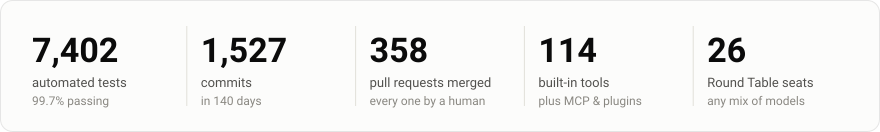
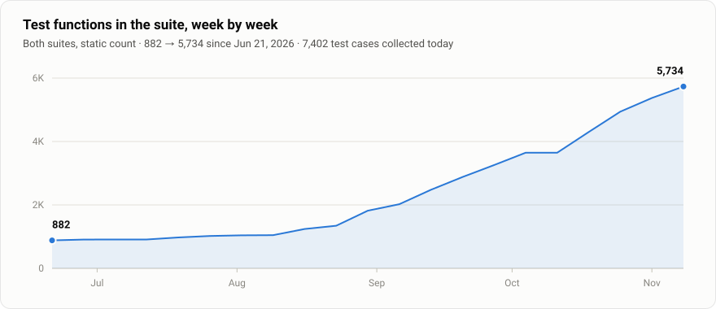

  

<h1 align="center">Dulus</h1>

  <b>One agent, made of many.</b> 
  The open-source core behind the Dulus desktop app.

  <a href="https://dulus.ai/download/"><b>Download the app</b></a>

  <picture>
    <source media="(prefers-color-scheme: dark)" srcset="assets/at-a-glance-dark.svg">
    
  </picture>

---

## "That's it?"

If you installed Dulus from GitHub and thought *that's it?* — you met the core, not the app.

Dulus started as this: an open-source terminal agent — still free, still a fine place to hack. The **Dulus desktop app** is everything that grew on top of it, built on a private codebase and downloaded from [dulus.ai](https://dulus.ai/download/). This page is the public face of that app — what it does, how it's tested — while the open core below stays open.

> Dulus is an AI agent for your desktop and terminal. It works in your files, your shell, your browser and your screen — on any model you choose. And when one mind isn't enough, it calls the flock.

## One agent. Made of many.

### The Round Table
Seat up to **26 AI agents** — any mix of models — at one table with a shared task board. They split the work, call on each other by name, and bring you the decisions only you can make as cards with options and a recommended pick. Open the live view to watch the table work, drawn from real events, never invented — then take a photo or record it.

### Hands on your computer
Dulus sees the screen, clicks and types in any app, in any language — accents, ñ and emoji included. A small live overlay follows along over full-screen apps, so you can watch, approve or stop it with one click.

### Astral Voice
Talk to it. It starts answering out loud while it's still writing, lets you cut in, and keeps the whole conversation in a transcript beside the orb.

### Your phone, same conversation
Pair Telegram with a QR code and keep going from anywhere: text, voice notes, photos and files, live progress with a stop button, approvals as buttons.

### Memory that doesn't lie to you
Memories stay with the profile and project they came from. Stale facts get flagged instead of trusted, newer facts replace older ones, and old ones are archived, never silently deleted. Long conversations stay searchable even after they're compacted.

### Any model
**40+ provider integrations** — the major APIs, local runtimes, and Dulus's own hosted models — with one reasoning dial for all of them, context windows up to a million tokens where the provider offers them, and requests shaped to stay cached so long sessions cost less.

### Make things
Images and video with your own keys: FLUX.2, GPT Image, Gemini and Imagen, Meta Muse, Veo, Sora 2 and more. Drag a result back in as a reference and keep going. Documents and mini apps the agent builds land in a versioned **Artifacts** library.

### Grows with you
A market of **~1,800 MCP servers** that install from inside the app, runtimes included. Skills. Plugins that reload live. And **AutoAdapter**: point it at a GitHub repo and get tools that are verified before they're switched on.

### And everything around it
A real browser pane, a live terminal panel, a steer bubble to talk to Dulus mid-task without stopping it, a Stop that really stops, checkpoints with undo and fork, HTML reports, a Tasks board, Dulus OS, a desktop pet, 14 themes and 34 languages.

## Measured. Not claimed.

Dulus is built by one developer, [Kevin Rojo](https://x.com/KevRojo), and a crew of AI coding agents. The agents write code and open pull requests. Kevin directs, decides and merges — all 358 of them. Every agent reads a shared log before touching anything, and signs an entry when it's done: what it did, what's missing, what broke, and what it did **not** verify.

  <picture>
    <source media="(prefers-color-scheme: dark)" srcset="assets/tests-growth-dark.svg">
    
  </picture>

- **7,402 automated tests.** The latest full run (Nov 8, 2026) passed 7,362; the 24 failures are known and tracked.
- **Every fix ships with a test that fails without it** — and we break each fix on purpose to prove a test catches it.
- **1,527 commits in 140 days.** About 80% of them pushed by AI agents, including Dulus working on itself.

## Two editions, one bird

| | **Dulus** — open source | **Dulus desktop app** — the full product |
|---|---|---|
| **What it is** | The terminal agent where it all started | The full product: desktop app, terminal and phone |
| **Get it** | This repo · `pip install dulus` | [dulus.ai/download](https://dulus.ai/download/) |
| **Source** | Open | Private. The app shows the work, not the code |
| **Price** | Free | Free app. Dulus-hosted models are paid by the token, in Fuel |

Everything on this page lives in the desktop app.

## Get it

**[Download Dulus](https://dulus.ai/download/)** for Windows 10/11 (x64). macOS (Apple Silicon) and Linux builds appear on the same page as they're published.

**Free to fly. Pay only for the fuel.** The app is free, and you sign in with a free Dulus account. Your own keys and local models cost nothing from Dulus; Dulus-hosted models are paid by the token in [Fuel](https://dulus.ai/fuel/). See [pricing](https://dulus.ai/pricing/).

## FAQ

### Is the desktop app open source?
No. Dulus, the open-source core you're looking at, is — and stays that way. The desktop app's source isn't published; this page shows what it does, how it's built and how it's tested.

### Why keep it private?
Because a lot of what's on this page exists nowhere else, and we'd rather show the work than hand over the blueprint.

### Where do the numbers come from?
From the repository itself — git history, line counts and a full test run — measured on November 8, 2026, with the same method every time so the numbers stay comparable.

### Is $DULUS an investment?
No. $DULUS is a utility and community token used to pay for Fuel on Dulus. Nothing here is financial advice.

### Where do I report a bug?
[Open an issue](../../issues/new/choose) here, or write to hello@dulus.ai. Security reports go privately to security@dulus.ai.

## Built by one. Backed by many.

Made by Kevin Rojo, a solo developer in Santo Domingo, with a crew of AI agents. Supported by **Datadog**, **Cloudflare**, **Sentry**, **Mixpanel**, **Amplitude**, **AWS Activate**, **Claude for Startups**, **DigitalOcean Hatch**, **Notion** and **Zendesk**.

## Why a bird?

Dulus is named after the palmchat — the *cigua palmera*, national bird of the Dominican Republic. It lives on Hispaniola and nowhere else on Earth, and it's the only species in its family.

Palmchats live in flocks. Together they build one great nest of twigs, high in the royal palms, and inside it every pair keeps its own chamber with its own entrance. One roof, many rooms. Dulus is made the same way: one human, Kevin Rojo, sets the direction; a flock of agents does the work.

Named after the bird, not the rocket. Built in Santo Domingo 🇩🇴 · We keep flying.

